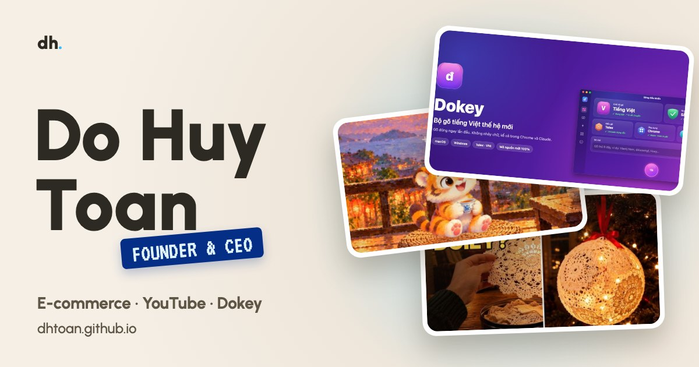

<div align="center">

<a href="https://dhtoan.github.io/"></a>

<br>

[](https://dhtoan.github.io/)
[](https://dhtoan.github.io/press/)
[](https://dhtoan.github.io/vi/)


[](https://www.youtube.com/@dhtoan)

# dhtoan.github.io

**Trang giới thiệu + press kit của Đỗ Huy Toàn**: một studio 3D tự vẽ bằng code, cuộn trang là “bay” từ văn phòng sang phòng hologram.

[**Xem trang**](https://dhtoan.github.io/) · [Press kit](https://dhtoan.github.io/press/) · [Dokey](https://github.com/dhtoan/Dokey) · [Tiểu sử dùng chung](BIO.md)

</div>

---

## ✨ Điểm nổi bật

| | |
|---|---|
| 🧱 **3D tự dựng 100%** | Văn phòng, nhân vật chibi, phòng hologram và cảnh ngủ gật ở phần Liên hệ đều dựng bằng three.js trong code. Không tải model, texture hay font 3D nào. |
| 🎬 **Kể chuyện theo cuộn trang** | Cửa sổ văn phòng nhấc lên, nhân vật nhảy ra đứng trên bục hologram, các bảng HUD tự gõ chữ theo tiến độ cuộn. |
| 🛟 **Máy không có WebGL vẫn đẹp** | Kiểm tra WebGL ngay khi tải. Máy không hỗ trợ thì **không tải three.js** (tiết kiệm hơn 1 MB) và hiện bản dự phòng: bục hologram bằng CSS + ảnh ghép các dự án. |
| ⌨️ **Thẻ Dokey có demo gõ** | Thẻ nổi bật gõ từng phím Telex (`dduowngf` → **đường**) để khách thấy ngay Dokey làm gì. |
| 📊 **Dải số liệu** | 33K+ người đăng ký, 24M+ lượt xem, 3 kênh, 20.635 bài kiểm thử Dokey. Số chạy lên khi cuộn tới. |
| 🎵 **Nhạc soạn bằng code** | Vòng hợp âm Fmaj7–Em7–Dm7–Cmaj7 phát trực tiếp bằng WebAudio, tắt cho tới khi khách bấm bật. |
| 🌐 **Song ngữ tự động** | Trình duyệt tiếng Việt hoặc múi giờ Việt Nam → `/vi/`, còn lại → tiếng Anh. Lựa chọn của khách được nhớ lại. |
| 🔎 **Sẵn cho Google** | JSON-LD `ProfilePage` + `Person` + `SoftwareApplication` (Dokey), `hreflang`, sitemap, ảnh chia sẻ 1200×630. |
| ♿ **Tôn trọng người dùng** | Bật “giảm chuyển động” thì mọi hiệu ứng dừng; có link “Skip to content”, focus rõ ràng, ARIA cho HUD. |

## 🗂 Dự án đang giới thiệu

| | Dự án | Mô tả |
|---|---|---|
| ⌨️ | [**Dokey**](https://github.com/dhtoan/Dokey) | Bộ gõ tiếng Việt miễn phí cho macOS và Windows (Telex, VNI), viết lại từ đầu bằng C++17 và Swift. Không nhảy chữ, không mất chữ trong Chrome, Claude, Electron. |
| 🎄 | [**Do Huy Toan**](https://www.youtube.com/@dhtoan) | Ý tưởng DIY Giáng sinh phát sáng và chuyện một phút về ngày lễ xưa ở Mỹ. |
| 🐯 | [**A Day of JD**](https://www.youtube.com/@jdfamilia) | Hoạt hình không lời về chú hổ con ở Đài Loan, phong cách tranh Monet, tiêu đề 5 ngôn ngữ. |
| 🗺 | [**Map a Day**](https://www.youtube.com/@MapADay) | Địa lý bất ngờ trong chưa đầy một phút, trên ảnh vệ tinh NASA Blue Marble. |
| 🛍 | Thương hiệu TMĐT | Sắp ra mắt |
| 🎮 | Nền tảng game HTML5 | Sắp ra mắt |

## 📁 Cấu trúc

```text
.
├── index.html          Trang chính tiếng Anh (JSON-LD ProfilePage + Person)
├── vi/index.html       Trang tiếng Việt (trỏ về cùng Person)
├── press/index.html    Press kit: số liệu, 3 bản tiểu sử có nút Copy, gợi ý bài viết
├── BIO.md              Tiểu sử EN/VI dùng nguyên văn ở mọi nơi
├── assets/
│   ├── scene.js        Toàn bộ cảnh 3D (three.js), chỉ tải khi máy có WebGL
│   ├── home.js         Cuộn trang, HUD, nav, số liệu, demo gõ Dokey, nhạc WebAudio
│   ├── lang.js         Tự chuyển EN/VI
│   ├── reveal.js       Hiện dần khi cuộn (press kit)
│   ├── site.css        Giao diện: be ấm + phòng lab xanh, điện thoại, bản dự phòng
│   ├── favicon.svg     Biểu tượng tab
│   ├── og.jpg          Ảnh khi chia sẻ link (1200×630)
│   └── img/            Ảnh thẻ dự án (800×450)
├── sitemap.xml
└── robots.txt
```

## 🚀 Chạy thử trên máy

Trang tĩnh, không cần build hay `npm install`. Chỉ tải three.js (jsDelivr) và font (Google Fonts) từ bên ngoài.

```bash
python3 -m http.server 8000
```

Mở <http://localhost:8000/?lang=en> (hoặc `/vi/?lang=vi`). Tham số `?lang=` giữ nguyên ngôn ngữ, không tự chuyển.

> Mở thẳng file `index.html` (đường dẫn `file://`) sẽ không chạy được cảnh 3D, vì trình duyệt chặn ES module. Luôn chạy qua một server như trên.

## 🌐 Tự chuyển ngôn ngữ

- Lần đầu vào trang: trình duyệt tiếng Việt **hoặc** múi giờ `Asia/Ho_Chi_Minh` → `/vi/`; còn lại → tiếng Anh.
- Bấm “Tiếng Việt” / “English” thì trang nhớ lựa chọn (localStorage), lần sau không tự chuyển nữa.
- Bot của Google không bị chuyển hướng; hai trang nối nhau bằng `hreflang`, nên đều được lập chỉ mục.
- Link có `?lang=…` thì không tự chuyển. Ví dụ gửi cho báo Mỹ: `https://dhtoan.github.io/?lang=en`.

## 🔄 Khi cập nhật

**Số liệu kênh**: sửa `BIO.md` trước, rồi chép đúng câu sang 3 trang HTML và phần About của các kênh. Nhớ cập nhật cả dải số liệu (`<ul class="stats">`) trong `index.html` và `vi/index.html`.

**Thêm dự án**: chép một khối `<a class="card">` trong phần `#projects`, ảnh 800×450 đặt ở `assets/img/`. Dự án cần làm nổi bật thì dùng `card card-feature` (chiếm cả hàng). Thêm dự án vào mảng `owns` trong JSON-LD của `index.html`.

**Sau mỗi lần sửa**: cập nhật `dateModified` trong JSON-LD và `lastmod` trong `sitemap.xml`.

## ✅ Còn cần làm

- [ ] **Email**: tìm comment `EMAIL` trong `index.html`, `vi/index.html`, `press/index.html`, thay link “Contact” bằng `mailto:`.
- [ ] **Ảnh chân dung**: lưu ảnh vuông ≥ 800×800 tại `assets/portrait.jpg` rồi đổi `"image"` trong JSON-LD sang ảnh đó (hiện đang dùng `og.jpg`).
- [ ] **Google Search Console**: dán thẻ `google-site-verification` vào chỗ comment trong `<head>` của `index.html`, rồi gửi `sitemap.xml`.
- [ ] Thêm `https://dhtoan.github.io/` vào phần Links của @dhtoan, @jdfamilia, @MapADay để Google nối các hồ sơ với nhau.

## 🙏 Ghi công

Ý tưởng bố cục lấy cảm hứng từ portfolio của David Heckhoff ([david-hckh.com](https://david-hckh.com)); toàn bộ code ở đây viết mới từ đầu.

<div align="center">
<sub>© 2026 Đỗ Huy Toàn · <a href="https://github.com/dhtoan">@dhtoan</a></sub>
</div>
